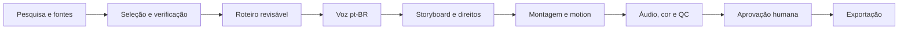

# Dex Video Studio

Motor local, privado e revisável para produção audiovisual assistida pela **Dex**.
O Ollama é o runtime atual do modelo; a identidade, os fluxos e as ferramentas
pertencem ao projeto Dex.

> **Status:** desenvolvimento ativo · **Execução:** local-first · **Publicação:**
> sempre exige confirmação humana.

## Visão geral



O Ollama decide e registra o plano. Ferramentas determinísticas executam mídia:
FFmpeg, Auto-Editor, VoiceStudio e, quando autorizado, yt-dlp. O modelo não recebe
permissão genérica para executar comandos do Windows.

## Início rápido

```powershell
.\Dex-Video.ps1 doctor
.\Dex-Video.ps1 new --name noticia-semanal --channel noticias
.\Dex-Video.ps1 init-weekly-news --project noticia-semanal --week-start 2026-11-16
.\Dex-Video.ps1 collect-news --project noticia-semanal --query "principais notícias do mundo hoje" --limit 20
.\Dex-Video.ps1 rank-news --project noticia-semanal --count 5
.\Dex-Video.ps1 plan --project noticia-semanal --brief "Cinco acontecimentos relevantes da semana"
.\Dex-Video.ps1 research --project noticia-semanal --query "notícias mundiais importantes desta semana" --limit 8
.\Dex-Video.ps1 draft --project noticia-semanal --brief "Cinco acontecimentos em linguagem humana e sóbria"
.\Dex-Video.ps1 storyboard --project noticia-semanal
.\Dex-Video.ps1 media-queries --project noticia-semanal
.\Dex-Video.ps1 media-candidates --project noticia-semanal --limit 5
.\Dex-Video.ps1 narrate --project noticia-semanal --text "Texto aprovado" --voice demo0001
.\Dex-Video.ps1 silence --project noticia-semanal --input "C:\caminho\video.mp4"
.\Dex-Video.ps1 transcribe --project noticia-semanal --input "C:\caminho\video.mp4" --gpu
.\Dex-Video.ps1 highlights --project noticia-semanal --input "C:\caminho\video.mp4" --count 5 --gpu
.\Dex-Video.ps1 render-highlights --project noticia-semanal
.\Dex-Video.ps1 render-shorts --project noticia-semanal
.\Dex-Video.ps1 auto-highlights --project noticia-semanal --input "C:\caminho\video.mp4" --count 5 --gpu
.\Dex-Video.ps1 master-audio --project noticia-semanal --input "C:\caminho\voz.wav"
.\Dex-Video.ps1 qc --project noticia-semanal --input "C:\caminho\video-final.mp4"
.\Dex-Video.ps1 review-video --project noticia-semanal --input "C:\caminho\video-final.mp4"
```

`silence` gera uma timeline FCPXML editável para importar no DaVinci Resolve. O
arquivo original nunca é apagado. `research` coleta resultados, mas não os trata
como fatos: fontes, datas e direitos de uso continuam sujeitos à revisão humana.

`highlights` é o caminho automático para vídeos existentes: transcreve localmente
com o Whisper incorporado ao FFmpeg, pede ao Ollama que sugira trechos contínuos e
gera um plano JSON e uma timeline EDL para o DaVinci Resolve. A seleção fica marcada
como pendente de revisão; o sistema não publica nem exclui o original.

`auto-highlights` executa em sequência a seleção, a timeline editável, a prévia
horizontal e os shorts 9:16 legendados. O recorte vertical acompanha rosto ou
movimento localmente e as legendas ficam em grupos de até seis palavras na área
segura, sem caixa preta. Por padrão, a transcrição usa o modelo
local `ggml-large-v3-turbo-q5_0.bin`; use `--retranscribe` quando precisar refazer
uma transcrição antiga com o modelo atual.

O rastreamento usa `opencv-python-headless==4.12.0.88` e o modelo local OpenCV YuNet
`models/face_detection_yunet_2023mar.onnx` (SHA-256
`8F2383E4DD3CFBB4553EA8718107FC0423210DC964F9F4280604804ED2552FA4`). Se o
modelo não estiver disponível, o sistema volta ao detector Haar e movimento.

`master-audio` usa normalização EBU R128 em duas passagens e preserva o arquivo de
entrada. `qc` mede resolução, FPS, sincronização, loudness e true peak, e gera um
relatório em `06-revisao`. O perfil atual é YouTube 1080p/30 fps e -14 LUFS.

`review-video` cria uma folha com quadros distribuídos pelo vídeo e mede mudanças
visuais bruscas, quadros escuros ou desfocados, presença e centralização de rostos.
O relatório é comum ao Dex Video Studio e ao Codex; a aprovação estética ainda
exige inspeção da folha por uma pessoa ou por um modelo com visão.

O comando `draft` rejeita URLs inventadas pelo modelo. O resultado continua sendo
um rascunho: ele não é narrado nem publicado sem aprovação.

`storyboard` converte o roteiro revisado em cenas rastreáveis com direção visual,
fontes, mídia, transição, som, direitos e aprovação. Ele não baixa mídia nem renderiza
antes que os campos pendentes sejam preenchidos.

`media-queries` transforma cada cena aprovada em termos de busca limitados ao roteiro.
`media-candidates` consulta o Wikimedia Commons, aceita apenas licenças compatíveis e
gera candidatos com autor, licença e página de origem para revisão humana. Nada é
baixado ou incorporado à edição sem registro de direitos.

`rank-news` aplica os pesos editoriais ao conjunto semanal, em lotes pequenos para
não estourar o contexto local. O ranking é explicitamente preliminar: assuntos com
uma única fonte permanecem não verificados e não viram roteiro automaticamente.

A ordem oficial e os gates estão em `PROCEDIMENTO-PRODUCAO.md`. O comando
`init-weekly-news` cria o conjunto persistente de pautas da semana; pesquisas futuras
alimentarão esse arquivo em vez de perder os candidatos do dia anterior.

O template local de motion design está em `templates/noticias-editorial`. Ele usa
HyperFrames, GSAP e fonte Inter locais; nenhuma CDN é necessária para renderizar.
As regras editoriais e técnicas estão em `GUIA-QUALIDADE.md`.

## Timeline visual e desfazer

O MakeMyClip Editor 0.5.2 foi instalado de forma local e fixada nessa versão. Ele
complementa o orquestrador com timeline JSON, histórico, desfazer/refazer, remoção de
retakes, verificação de cortes e exportação FCPXML. O wrapper usa o FFmpeg e o modelo
Whisper que já existem, sem baixar outra cópia:

```powershell
.\MakeMyClip.ps1 doctor
.\MakeMyClip.ps1 ui
```

O workspace padrão legado é `%USERPROFILE%\IA\Ollama-Video-Studio\state\makemyclip-workspace`.
O orquestrador pode usar um workspace por projeto por meio de
`OLLAMA_VIDEO_MAKEMYCLIP_WORKSPACE`. A interface liga somente em `127.0.0.1` e não
exige conta nem chave de API.

## Privacidade e publicação

Este repositório deve permanecer privado durante o desenvolvimento. Antes de cada
envio, execute `powershell -NoProfile -File scripts/check_repository_safety.ps1`.
O GitHub recebe apenas o motor sanitizado; projetos, vozes, mídias, modelos, logs,
memória pessoal e credenciais permanecem fora do Git.

Antes de publicar ou clonar em outra máquina, leia `PUBLICO-E-PRIVADO.md`.
O repositório guarda somente o motor. Vozes, vídeos, projetos, modelos, caches,
históricos e credenciais permanecem locais e são ignorados pelo Git.

As decisões sobre projetos de terceiros ficam em `INTEGRACOES-EXTERNAS.md` e
`config/integrations/repositories.json`. Repositórios externos não são executados
nem recebem dados pessoais apenas por constarem no catálogo.

## Estrutura do repositório

| Área | Responsabilidade |
|---|---|
| `src/` | Orquestração, análise, reenquadramento e revisão de mídia |
| `config/` | Fluxos, qualidade, áudio e provedores controlados |
| `templates/` | Motion design e identidade editorial local |
| `scripts/` | Verificações determinísticas de segurança |
| `tests/` | Regressões de legenda, câmera, credenciais e QC |
| `PROJECT-STATE.md` | Ponto de continuação sanitizado para outra IA |

## Segurança por padrão

- O repositório permanece privado durante o desenvolvimento.
- Mídia, voz, modelos, credenciais, memória pessoal e logs não entram no Git.
- Downloads exigem fonte e direitos registrados.
- Publicação e exclusão de originais nunca são automáticas.
- Processos externos recebem somente variáveis de ambiente permitidas.

## Uso profissional do GitHub

Trabalhe em uma branch por mudança, escreva commits pequenos e objetivos, abra um
pull request para revisão e só integre depois dos testes e da verificação de
segurança. Não coloque chaves, áudios, vídeos ou bancos pessoais em issues, commits
ou arquivos do repositório.


